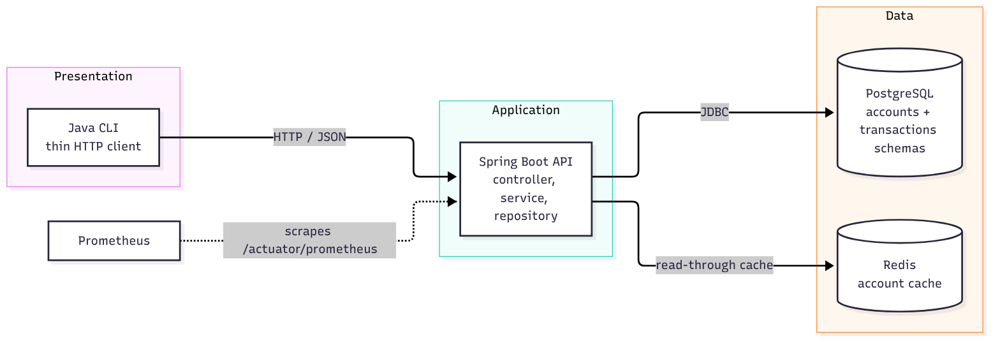

# Banking Platform

A small banking backend built as three tiers: a Java CLI, a Spring Boot API, and PostgreSQL with Redis. It grows over ten weeks into microservices on AWS, deployed with Terraform and TeamCity and monitored in Grafana. The full plan is in [docs/roadmap.md](docs/roadmap.md).

**Current state:** weeks 1 to 4 are scaffolded. Deposit, withdraw and transfer are not implemented yet. Their spec is the `MoneyMovement` tests in [`AccountServiceTest`](api/src/test/java/com/example/service/AccountServiceTest.java), which stay `@Disabled` until the rules are written. Until then those endpoints return `501 NOT_IMPLEMENTED`.

## Architecture

Each tier only talks to the tier next to it. The CLI never touches the database.

Where it is heading (weeks 7 to 9):

Diagram sources (Mermaid) are in [docs/diagrams](docs/diagrams).

Grafana never connects to RDS or Redis directly. It reads their health from CloudWatch, so the data tier only accepts traffic from the services.

